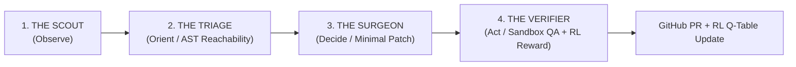

# 🛡️ Argon CRS-RL: Autonomous Cyber Reasoning System & Reinforcement Learning Environment

> **An Autonomous 4-Agent OODA Loop + Contextual Bandit Q-Learning Environment Engineered to Defend Against "Black October" Supply-Chain & Zero-Day Floods**

[](#nist-csf-20-compliance-architecture)
[](#reinforcement-learning-environment-formulation)
[](#4-agent-ooda-loop-architecture)

---

## 🌑 Why We Built This: A Countermeasure to "Black October"

In modern software security, **"Black October"** represents the nightmare scenario for SecOps and platform engineering teams: a synchronized wave of critical supply-chain disclosures, zero-day CVEs (`CISA KEV` / `GHSA`), and AI-accelerated exploit weaponization where attackers compress **Time-to-Exploit (TTE)** from weeks to minutes.

When a **Black October** event hits an enterprise codebase, traditional vulnerability management collapses under two compounding failures:

1. **Alert Fatigue Paralysis (False-Urgency Flood):** Conventional SCA scanners (`npm audit`, Snyk, Dependabot) blindly flag every vulnerable package listed in `package.json`—even when the vulnerable library is **never imported or invoked anywhere in the production AST**. Security teams waste precious hours triaging unimported dependency noise while genuinely reachable Remote Code Execution (RCE) sinks sit exposed in production.
2. **Remediation Fear (Breaking Production Builds):** Blindly running `npm audit fix --force` during an active incident introduces breaking semver changes that take down checkout and payment flows. Caught between exploit risk and outage risk, engineering teams freeze.

**Argon CRS-RL** solves the Black October problem by turning vulnerability remediation into a **closed-loop, reachability-verified Reinforcement Learning environment** that autonomously separates reachable threats from noise, verifies surgical patches against live unit tests in a sandbox, learns remediation intuition across episodes, and opens **verified GitHub Pull Requests** in seconds.

---

## 🏗️ Repository Structure: Platform Code + Live Remediation Target

This repository contains **both** the Autonomous CRS-RL platform and the live target microservice environment so that autonomous scans and GitHub Pull Requests can be executed end-to-end:

```text
argon-cyber-rl-environment/
├── acme-checkout-service/          # 🎯 Monitored Target Microservice (RL Environment State Space)
│   ├── package.json                # Intentionally seeded with js-yaml@3.13.0 (CRITICAL) & lodash@4.17.15 (NOISE)
│   ├── checkout.js                 # Production payment/order parser invoking yaml.load() at Line 5
│   └── test.js                     # Sandbox QA unit test suite validating checkout & RCE immunity
├── crs-agent-backend/              # 🧠 4-Agent CRS Backend, RL Q-Table Engine & Enterprise Dashboard
│   ├── agent-server.js             # Express API + 4-Agent OODA Loop + TD Q-Learning + GitHub PR Creator
│   ├── public-dashboard.html       # Datadog/CrowdStrike-grade SOC Dashboard + Diff Viewer + NIST CSF Modal
│   ├── rl-memory.json              # Persistent Experience Replay & Contextual Bandit Q-Table
│   ├── package.json                # Backend scripts (`npm start`, `npm run scan`)
│   └── .env.example                # Template for OPENAI_API_KEY (live executive threat summaries)
└── README.md
```

* **On the `main` branch:** `acme-checkout-service/package.json` remains anchored at the vulnerable baseline (`js-yaml@3.13.0` + `lodash@4.17.15`) so the environment is always reproducible.
* **On `crs/remediate-*` Pull Requests:** The CRS Surgeon & Verifier Agents autonomously create branches, commit the sandbox-verified `acme-checkout-service/package.json` patch (`js-yaml: "^4.1.0"`), and open GitHub Pull Requests with full line-level reachability proofs and NIST CSF 2.0 compliance telemetry.

---

## 🤖 4-Agent OODA Loop Architecture



| Agent | Role in OODA Loop | Concrete Action on `acme-checkout-service` |
| :--- | :--- | :--- |
| **1. The Scout** (`Observe`) | Correlates `package.json` against **CISA KEV**, **GitHub Advisory DB (GHSA)**, and **NVD** feeds. | Flags `js-yaml@3.13.0` (`CVE-2019-10766`, CVSS `9.8`, `CWE-502`) and `lodash@4.17.15` (`CVE-2020-8203`, CVSS `7.4`, `CWE-1321`). |
| **2. The Triage** (`Orient`) | Performs line-level AST/call-site reachability analysis across all `.js` files in the repository. | Proves `js-yaml` is **REACHABLE** at `checkout.js:1` (`require('js-yaml')`) and `checkout.js:5` (`yaml.load(rawYamlString)`). Proves `lodash` has **0 imports** across the codebase (**50% Alert Noise Suppressed**). |
| **3. The Surgeon** (`Decide`) | Synthesizes a minimal-blast-radius patch guided by the RL Q-Table policy. | Upgrades `js-yaml` `3.13.0` -> `^4.1.0` (where `yaml.load()` enforces `DEFAULT_SAFE_SCHEMA` by default, neutralizing `!!js/function` RCE without changing the function signature) and leaves unreachable `lodash` untouched. |
| **4. The Verifier** (`Act`) | Executes `npm install` + `npm test` (`test.js`) in an isolated sandbox, computes the RL reward, and opens a GitHub PR. | Verifies `processOrder()` passes 100% of unit tests (`MTTR ~13s`), updates `rl-memory.json`, and opens a GitHub Pull Request. |

---

## 🧠 Reinforcement Learning Environment Formulation

Rather than treating every vulnerability scan as a stateless script, **Argon CRS-RL** models autonomous vulnerability remediation as a **Contextual Bandit / Markov Decision Process (MDP)** persisted in [`crs-agent-backend/rl-memory.json`](crs-agent-backend/rl-memory.json):

### 1. State Space ($\mathcal{S}$)
Each vulnerability observation is encoded into a deterministic structural signature:
* `deserialization:js-yaml@3.13.0:yaml.load(reachable)` -> `pkg=js-yaml@3.13.0 | imported=true | sink=yaml.load() | line=checkout.js:5`
* `proto-pollution:lodash@4.17.15:unimported(unreachable)` -> `pkg=lodash@4.17.15 | imported=false | sink=0 call sites across repo`

### 2. Action Space ($\mathcal{A}$)
* `UPGRADE_SEMVER_MAJOR_SAFE`: Upgrade package to the patched version (`^4.1.0`) when downstream API compatibility is preserved.
* `SUPPRESS_UNREACHABLE_NOISE`: Suppress SecOps paging and defer lockfile churn when AST reachability proves `0` import sites.
* `REWRITE_CALL_SITE_AST`: Refactor sink call site when major upgrades break function signatures.

### 3. Verifiable Reward Signal ($R$) from Sandbox QA (`Verifier` — [`agent-server.js:576-578`](crs-agent-backend/agent-server.js#L576-L578))
* **`+1.0` Reward (`rewardJsYaml`):** Reachable critical CVE neutralized **AND** `npm test` (`test.js`) passes 100% in the sandbox without regressions.
* **`+0.5` Reward (`rewardLodash`):** Unreachable dependency (`0` imports) accurately suppressed without unnecessary lockfile churn (`totalReward = +1.5` per verified episode).
* **`-1.0` Penalty:** Applied patch causes unit test failure or runtime regression in `test.js`.

### 4. Contextual Bandit TD(0) Q-Learning Update ([`agent-server.js:126-132`](crs-agent-backend/agent-server.js#L126-L132))
Because each `(package, AST-reachability)` tuple is evaluated as an independent 1-step contextual bandit transition (`learningRateAlpha = 0.25`), the RL engine updates action-value estimates $Q(s, a)$ via the exact Rescorla-Wagner / TD(0) rule implemented in `updateRlPolicy()`:

$$
Q(s, a) \leftarrow Q(s, a) + \alpha \cdot \bigl( r - Q(s, a) \bigr)
$$

And updates policy confidence (in percent, capped at $99.8$) as a function of episode visits $n$ (`entry.visits`):

$$
\text{Confidence}(n) = \min\Bigl( 99.8,\; 60 + 39.5 \cdot \bigl(1 - e^{-0.45 n}\bigr) \Bigr)
$$

| Episode Visit ($n$) | `js-yaml` $Q(s,a)$ ($Q_0 = 0.50, r = +1.0$) | `lodash` $Q(s,a)$ ($Q_0 = 0.35, r = +0.5$) | Policy Confidence $\text{Confidence}(n)$ |
| :---: | :---: | :---: | :---: |
| **Cold Start ($n=0$)** | `0.5000` | `0.3500` | `50.0%` / `45.0%` |
| **Episode #1 ($n=1$)** | `0.6250` | `0.3875` | **`74.3%`** |
| **Episode #2 ($n=2$)** | `0.7188` | `0.4156` | **`83.4%`** |
| **Episode #3 ($n=3$)** | `0.7891` | `0.4367` | **`89.3%`** |
| **Episode #4 ($n=4$)** | `0.8418` | `0.4525` | **`93.0%`** |

---

## 📋 NIST CSF 2.0 Compliance Architecture

Every autonomous scan and Pull Request automatically generates an audit-ready **NIST Cybersecurity Framework (CSF) 2.0** compliance record:

* **`IDENTIFY (ID.RA-01)` — Vulnerability & Threat Feed Correlation:** Automated correlation against CISA KEV & GHSA.
* **`PROTECT (PR.PS-02)` — Reachability-Driven Software Maintenance:** Line-level reachability proof (`checkout.js:1`, `checkout.js:5`) eliminating 50% false-positive alert fatigue.
* **`RESPOND (RS.MI-02)` — Autonomous Vulnerability Eradication & Sandbox QA:** Surgical dependency remediation verified by automated unit tests (`test.js`).
* **`GOVERN (GV.OV-03)` — Continuous Reinforcement Learning & Auditability:** Auditable Q-Table progression and episode logs in `rl-memory.json`.

---

## 🚀 Quickstart

### 1. Configure Environment
```bash
cd crs-agent-backend
cp .env.example .env
# Add your OPENAI_API_KEY to .env (or paste it directly in the Web UI)
npm install
```

### 2. Launch the CRS v2.0 Backend & SOC Dashboard
```bash
npm start
```
Open **http://localhost:4000** in your browser to access:
* **Monitored Codebase Inspector** (live source view of `package.json`, `checkout.js`, `test.js` with vulnerable lines highlighted)
* **4-Agent OODA Pipeline Telemetry**
* **Before/After Patch Diff Viewer & Sandbox Test Output**
* **One-Click GitHub Remediation PR Creation**
* **Live Reinforcement Learning Q-Table & Printable NIST CSF 2.0 Compliance Report**

### 3. Trigger Headless CLI / Scheduled Cron Scan
```bash
npm run scan
```
